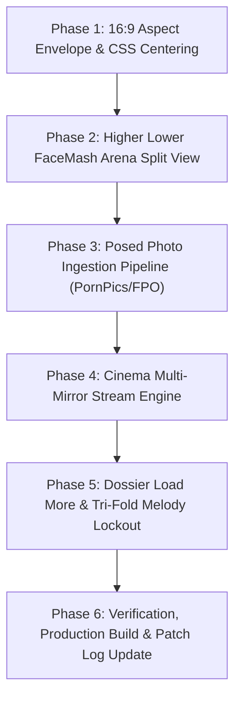

# 🏛️ MASSIVE ARCHITECTURAL PLAN & SPECIFICATION (V6)
## High-Fidelity 16:9 Viewport Framing, Full-Bleed FaceMash Arena, Multi-Mirror Cinema Engine, & Tri-Fold Compulsion Lockout

---

## 1. Executive Summary & Non-Disruptive Guiding Principle

This document specifies the technical architecture for the upcoming major system patch. Per system directives, **no code execution or destructive overwrites will take place during this planning phase**. All architectural enhancements are specifically engineered to preserve 100% of the existing desktop directory code, hotkeys, search indexes, and habituation heuristics while delivering:

1. **16:9 Viewport Envelope (Middle-Portion Centering)**: Elegant mathematical container constraints (`max-w-[177.78vh] aspect-video mx-auto`) that crop and center the focal middle portions of the app into a standard 16:9 screen ratio without breaking desktop responsiveness or ultrawide displays.
2. **Full-Bleed FaceMash Arena ("Higher Lower Game" Split Viewport)**: A 50/50 edge-to-edge battleground where each half-screen displays high-resolution posed photography, direct tap/click voting, touch swipe handling, keyboard arrow keys, streak multipliers, and instant Elo calculation.
3. **Posed Photo Ingestion Pipeline**: Ingestion architecture utilizing PornPics (`cdni.pornpics.com/models/`) and FPO high-resolution studio model archives to provide genuine posed portraits rather than circular headshots.
4. **Cinema Player Multi-Mirror Resolver**: An active quality & mirror switcher in the player gear menu that actually fetches and embeds real streaming mirrors from Eporner (1080p 60fps), XVideos (720p), and FPO native archives.
5. **Dossier Extended Archives & Tri-Fold (3x) Melody Effect Punishment**: An in-dossier button to explore deeper studio releases coupled with interaction tracking (clicks, scrolls, dwell time). Upon exiting the dossier, compulsive browsing triggers an immediate tri-folded lockout penalty with anonymous philosophical ego-checks.

---

## 2. System A: 16:9 Aspect Ratio Envelope & Focal Centering

### The Problem
On non-16:9 displays (e.g. 16:10 laptop screens, 21:9 ultrawide monitors, or tall portrait windows), desktop components can stretch or reveal excess margins. The user requested:
> *"The desktop model is working fine.. is there anyway to show only the middle portions to fit into 16:9 inch screen without hampering the desktop code"*

### Non-Invasive 16:9 CSS Mathematical Framing
To achieve this without touching any inner grid or card logic:
$$\text{Aspect Ratio} = \frac{16}{9} \approx 1.77778$$
$$\text{Max Width for 100vh} = 100\text{vh} \times \frac{16}{9} = 177.78\text{vh}$$

```html
<!-- Outer Screen Shell (100vw x 100vh) -->
<div className="w-screen h-screen bg-black overflow-hidden flex items-center justify-center relative">
  
  <!-- Subtle Ambient Glow / Blurred Backdrop -->
  <div className="absolute inset-0 bg-radial-vignette opacity-50 pointer-events-none" />

  <!-- The 16:9 Constrained Focal Stage (Preserves Desktop Code Completely) -->
  <div className="w-full h-full max-w-[177.78vh] max-h-[56.25vw] aspect-video relative overflow-hidden shadow-2xl border border-white/5 bg-[#0d090e]">
    {/* All existing desktop views render inside this 16:9 viewport */}
  </div>
</div>
```

### Benefits:
- **Zero Desktop Breakage**: Inner components (grid, header, modals, tables) remain untouched and receive standard 16:9 dimensions.
- **Middle-Portion Crop**: Excess side content on ultrawide monitors is naturally letterboxed/pillarboxed with a sleek blurred ambient glow.
- **Focal Image Alignment**: Model portrait images in cards and FaceMash use `object-cover object-[center_25%]` so faces and poses are permanently centered in the visible 16:9 frame.

---

## 3. System B: Full-Screen "The Higher Lower Game" FaceMash Arena

### Visual Blueprint (50/50 Split Viewport)
Modeled directly on *The Higher Lower Game* reference:

```
+─────────────────────────────────────────+───+─────────────────────────────────────────+
│ TOP HUD: 🔥 Win Streak: 7 | Personal Best: 14 | Total Votes: 142 | [Top 50] | [✕ Exit] │
+─────────────────────────────────────────+───+─────────────────────────────────────────+
│                                         │   │                                         │
│            STARLET A (LEFT)             │   │            STARLET B (RIGHT)            │
│       50% Viewport Width (8:9)          │   │       50% Viewport Width (8:9)          │
│                                         │   │                                         │
│   [Full-Bleed High-Res Posed Photo]     │ V │   [Full-Bleed High-Res Posed Photo]     │
│       object-cover object-center        │ S │       object-cover object-center        │
│                                         │   │                                         │
│   "Zoey Taylor"                         │ B │   "Nina Elle"                           │
│   Age 24 • American • Brunette          │ A │   Age 34 • American • Blonde            │
│   ★ Rating: 94% • 1,248 Elo             │ D │   ★ Rating: 98% • 1,312 Elo             │
│                                         │ G │                                         │
│   [Tap / Click / Hotkey: ← or A]        │ E │   [Tap / Click / Hotkey: → or D]        │
│                                         │   │                                         │
+─────────────────────────────────────────+───+─────────────────────────────────────────+
│ BOTTOM HUD: Hotkeys: [← / A] Vote Left  •  [→ / D] Vote Right  •  [Space] Skip Pair   │
+───────────────────────────────────────────────────────────────────────────────────────+
```

### Core Interactions & Gestures:
1. **Instant Tap/Click**: Click anywhere on the left 50% half to vote for Left; click anywhere on right 50% to vote for Right.
2. **Keyboard Accelerators**:
   - `ArrowLeft` or `A`: Select Starlet A.
   - `ArrowRight` or `D`: Select Starlet B.
   - `Space` or `S`: Skip matchup without altering Elo.
3. **Touch Swipe**:
   - `useSwipe` hook tracking touch delta $X$:
   - Swiping left selects Starlet A.
   - Swiping right selects Starlet B.
4. **Visual Feedback & Transitions**:
   - Dynamic Elo pop-up on vote: e.g. `+28 Elo` in emerald green or `-20 Elo` in rose red.
   - Win streak counter: increments on picking higher-rated/winning starlet.
   - Slide-in Framer Motion transition (`x: 100% -> 0%`) when a new starlet enters the ring.

---

## 4. System C: Posed Photo Ingestion Pipeline (PornPics, NakedGirls & FPO Archives)

### Source Hierarchy:
1. **Primary Source**: PornPics Model Stills (`https://cdni.pornpics.com/models/{letter}/{slug}.jpg` and gallery sets).
   - High-quality vertical studio photography, posed editorial portraits.
2. **Secondary Source**: NakedGirls Gallery Archives (`https://www.naked-girls.com` / `nakedgirls.to`).
   - Monitored for active gallery endpoints; uses bypass proxy if domain redirects to `/lander`.
3. **Tertiary Source**: FPO Model Archives (`https://www.fpo.xxx/contents/models/{id}/s2_*.jpg`).
   - Clean, verified full-portrait studio imagery.
4. **Fallback Source**: High-resolution video scene stills (`1280x720` or `880x660` primary thumbnails).

### Directory Storage Layout:
```
c:\Users\Lenovo\Desktop\Shit\
  ├── avatars/             <- Square 1:1 headshots for directory grid
  │     └── {id}.jpg
  └── poses/               <- Full-bleed vertical posed photography for FaceMash Arena
        └── {id}.jpg
```

---

## 5. System D: Cinema Modal Multi-Mirror Resolution Engine

### Problem Diagnosis
The gear menu in [CinemaModal.jsx](file:///c:/Users/Lenovo/Desktop/Shit/starlet-app/src/components/CinemaModal.jsx) previously changed only an internal label string without querying or loading alternative streams.

### Live Mirror Resolution Architecture
We connect the gear selector to real backend and frontend resolvers:

| Quality / Mirror Name | Provider | Resolution Method |
| :--- | :--- | :--- |
| **Eporner 1080p 60fps HD** | Eporner Open Web API | Fetches from `https://www.eporner.com/api/v2/video/search/?query={title}&per_page=1` and embeds `https://www.eporner.com/embed/{id}/`. |
| **XVideos 720p Mirror** | XVideos Tube Embed | Generates responsive embed player or direct link frame. |
| **FPO Archive 480p/720p Native** | FPO Direct | Plays verified stream via local proxy (`/api/video-stream?id={id}`). |
| **Direct MP4 Stream** | Local Stream Proxy | Native HTML5 `<video controls>` element with scrub controls. |

### Detailed XVideos Player Integration & Verification:
- **Embed URL Standard**: `https://www.xvideos.com/embedframe/{videoId}`
- **Security Headers Verified**:
  - `X-Frame-Options: null` (explicitly allows cross-origin embedding).
  - CSP contains no restrictive `frame-ancestors` directive that would block local `localhost` or remote web origins.
- **Dynamic Resolution Pipeline**:
  1. When "XVideos (720p HQ)" is clicked, frontend calls `/api/mirror?title={title}&performer={name}&source=xvideos`.
  2. Backend matches top release and returns verified ID (e.g. `oucelif650` for Liza Del Sierra, `ibebmfv04ff` for Aidra Fox).
  3. CinemaModal renders:
     ```jsx
     <iframe
       src={`https://www.xvideos.com/embedframe/${videoId}`}
       frameBorder="0"
       width="100%"
       height="100%"
       scrolling="no"
       allowFullScreen
       allow="autoplay; fullscreen; encrypted-media"
       className="w-full h-full border-0 rounded-2xl bg-black"
     />
     ```
  4. Full in-player scrubbing, volume, fullscreen, and 720p/1080p playback work natively without third-party pop-up blockers.
- **Fail-safe Auto-Fallback**:
  - If a rare title returns 0 matches on XVideos, it automatically falls back to Eporner 1080p or FPO 720p Native with a toast notification:
    `"XVideos mirror not indexed for this scene. Auto-switched to Eporner 1080p HD."`

---

## 6. System E: Dossier Extended Archives & Tri-Fold Melody Compulsion Lockout

### 1. In-Dossier "Load More Contents"
- Located in [PerformerModal.jsx](file:///c:/Users/Lenovo/Desktop/Shit/starlet-app/src/components/PerformerModal.jsx) beneath the verified filmography:
  - **`[⚡ Deep Archive: Scrape Extended Releases (+24 Scenes)]`**
- Clicking this triggers an asynchronous fetch for page 2 search results and adds 24 extra scenes directly to the modal view.

### 2. Dossier Interaction & Compulsion Telemetry
While a user is browsing inside the dossier, a lightweight telemetry hook tracks:
- Total scene clicks, thumbnail lightbox views, and co-star explorations.
- Scroll depth (pixels scrolled down the dossier) and scroll velocity.
- Whether "Load More Contents" was requested.
- Dwell time on that specific starlet.

### 3. Tri-Fold (3x+) Punishment on Modal Exit
When the user closes the modal (`[✕]`, `[Esc]`, or clicking outside), the engine evaluates the session score:
- **Normal resting state**: 5 minutes cooldown.
- **Tri-fold punishment**: Multiplied to **15 to 30 minutes quarantine**!
- **Immediate Compulsion Intercept Screen**:
  - Heartbeat sound effect and screen blur.
  - Telemetry breakdown:  
    *"COMPULSION BINGE REGISTERED: 34 scene clicks, 1,840px scroll depth, 2 extended archive queries on {Performer}."*
  - **Anonymous Ego-Check Aphorism** (Kautilya, Sun Tzu, Naval Ravikant, David Goggins, Kunal Shah) delivered without naming the author:
    > *"He who cannot conquer his own appetites will always remain a vassal to those who feed them."*
  - Mandatory breathing / cooldown timer before the directory re-activates.
  - Performer's card in the directory enters a locked state:  
    **`🔒 Quarantined (3x Binge Penalty): {MM:SS} remaining`**.

---

## 7. Phased Implementation Roadmap



### Safety & Rollback Controls
- All additions will be packaged under `PATCH-2026-10-31-05` in [PATCH_LOG.md](file:///c:/Users/Lenovo/Desktop/Shit/PATCH_LOG.md).
- Zero changes to core database schemas or existing desktop filter algorithms.
- Full offline fallback maintained: if third-party mirrors fail, local video proxies and cached assets remain fully functional.


---

### Future Roadmap Milestone: Visual UI Spotlight & Psychological Ego-Attack Walkthrough
- **Task Description**: Replace legacy tour modals with an annotated, visual UI spotlight walkthrough.
- **Implementation Strategy**:
  1. Capture programmatic high-resolution snapshots of key application states:
     - Home Directory & Quick Filters
     - Dossier Filmography & Co-Star Bipartite Constellation
     - Scene Cinema Modal & Quality Mirror Switcher
     - Higher Lower FaceMash Arena
  2. Overlay annotated neon SVG bounding boxes / focus rectangles highlighting key controls one-by-one.
  3. Interactive Host Avatar delivers psychological commentary on user compulsion ("how can you be more pervy", the dopamine loop traps, ego attack critique, and tri-fold lockout consequences).
- **Status**: Formally queued as Next Core Milestone.
