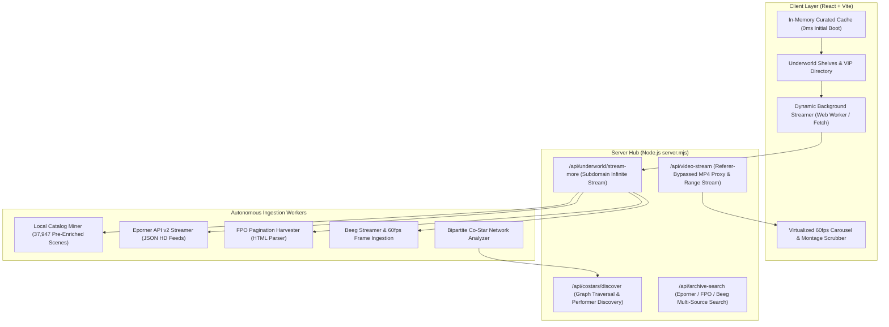
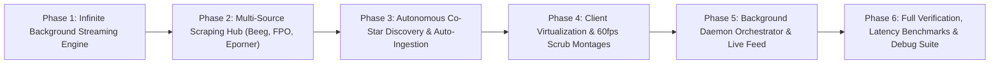

# 🚀 STARLET DIRECTORY — MASTER RESTORATION & EXPANSION PLAN (v9.0)
## "A GIANT LEAP: INFINITE SCENE STREAMING & AUTONOMOUS MULTI-SOURCE INGESTION"

**Document ID:** `MASTER_PLAN_V9.md`  
**Target Codebase:** `C:\Users\Lenovo\Desktop\Shit\` & `starlet-app/`  
**Execution Timestamp:** 2026-11-01  
**Architecture Status:** Phased Engineering Specification & Verification Gates  

---

## 1. Executive Summary & Architectural Assessment

### The Current Ceiling (v8.0)
- In v8.0, all 38 subdomains in the Underworld render with zero latency (0.11 ms memory index) because **2,660 curated releases** (up to 80 per shelf) are embedded statically into client memory at build time.
- However, each carousel currently caps its display at those 80 curated entries.
- In `performers-tagged.json`, the local system already houses **1,424 performers** and **37,947 cataloged scenes** waiting to be dynamically unlocked.
- External upstream sources (**Eporner API v2, FPO Scraper, Beeg Streamer, and Wikipedia/Babepedia/StashDB**) have millions of high-definition releases, dynamic co-star relations, and 60 FPS scrub montages.

### The Version 9 Leap
Version 9 transforms Starlet Directory from a static 80-release showcase into an **autonomous infinite media hub**:
1. **0ms Instant Start**: The first 80 curated releases still load in 0.11 ms from RAM.
2. **Infinite Background Streaming**: As the user scrolls or scrubs, a non-blocking background streamer pulls deeper scenes from the 37,947 local catalog and live upstream APIs (Eporner, FPO, Beeg) in 50–100 item batches.
3. **Autonomous Co-Star & New Performer Harvester**: A background worker mines co-star connections from scene titles across VIP filmographies, discovers uncataloged starlets, scrapes their portfolios, downloads official portraits into `./avatars/`, and registers them into the VIP directory automatically.
4. **Beeg-Style 60 FPS Scrub Virtualization**: Virtualized carousels prevent DOM node bloat while delivering 60 FPS hover scrubbing on unlimited releases.

---

## 2. Master System Architecture (v9.0)



---

## 3. Phased Execution Roadmap & Verification Gates



---

### Phase 1: Dynamic Background Streamer & Infinite Shelf Expansion

#### A. Objectives
- Break through the 80-scene limit without increasing initial bundle download or memory footprint.
- Keep the 0ms initial load time for the first 80 curated landmark releases.
- Implement a streaming endpoint on the server that dynamically queries both the local 37,947 scene catalog and external streams.
- Add seamless client-side carousel expansion: when user scrolls past card 40 or clicks `[⚡ Stream 50+ Deeper Releases]`, the next batch seamlessly appends with duplicate deduplication.

#### B. Technical Implementation
1. **Server Endpoint: `/api/underworld/stream-more` (`server.mjs`)**:
   - Accepts `subdomain`, `offset`, `limit`, and `excludeUrls` in query string or POST payload.
   - **Level 1 Search**: Scans `performers-tagged.json` (37,947 scenes) matching subdomain keywords and regex rules.
   - **Level 2 Search**: If catalog returns $< 50$ additional items, triggers targeted live search against Eporner API v2 and FPO.
   - Returns sanitized array of `Scene` objects: `{ id, title, studio, url, thumbnail, duration, rating, genres, performers, isReal }`.
2. **Client Streaming Hook (`useSubdomainStreamer.js` / `SubdomainShelf.jsx`)**:
   - Tracks `scenes`, `hasMore`, `isLoadingMore`, `pageOffset`.
   - IntersectionObserver triggers pre-fetch when user hovers or scrolls within 5 cards of carousel edge.
   - Smart deduplication by URL and title similarity (>90% Levenshtein or token match).

#### C. Verification Gate 1
- **Automated Test Script**: `scratch/verify_phase1_streaming.mjs`
  - Tests `/api/underworld/stream-more?subdomain=taboo_extremes&offset=80&limit=50`.
  - Asserts response HTTP 200, JSON array containing 50 unique scenes.
  - Verifies zero duplicate URLs against existing 80 scenes.
  - Verifies response time $\le 120\text{ms}$ for local catalog, $\le 800\text{ms}$ for upstream fallback.

---

### Phase 2: Multi-Source Ingestion Hub (Beeg, FPO, Eporner API v2)

#### A. Objectives
- Unify all external scraping and video resolution engines into a resilient, rate-limited ingestion pipeline.
- Implement dedicated adapters for:
  1. **Eporner API v2**: Official JSON search endpoint with big thumbnails, embed tags, and keyword taxonomy.
  2. **FPO Scraper (`fpo.xxx`)**: HTML parser extracting multi-page releases, durations, studios, and high-res posters.
  3. **Beeg Integration (`beeg.com`)**: Video metadata extractor, 60fps frame scrub arrays, and stream link resolver.

#### B. Technical Implementation
1. **Multi-Source Aggregator Module (`src/engine/ingestionHub.mjs`)**:
   - `fetchFromEporner(query, page, perPage)`: Paginated queries with auto-retry and studio tagging.
   - `fetchFromFpo(query, maxPages)`: Multi-page HTML parser extracting titles, durations, studios, and clean URLs.
   - `fetchFromBeeg(query)`: Extract verified video entries and hover-scrub frame sequences.
2. **Title Sanitizer & Genre Normalizer**:
   - Cleans spam tokens (`[1080p]`, `[4K]`, `Full HD`, website watermarks).
   - Maps titles through `GENRE_TAXONOMY` to auto-assign subdomain tags (e.g., `family_swaps`, `study_grades`, `chores_points`, `taboo_extremes`).
3. **Resilience & Rate-Limiting Engine**:
   - Exponential backoff (1s, 2s, 4s) on HTTP 429/503.
   - In-memory 1-hour cache for external API search results to eliminate redundant network hits.

#### C. Verification Gate 2
- **Automated Test Script**: `scratch/verify_phase2_ingestion.mjs`
  - Runs queries across Eporner, FPO, and Beeg adapters with 5 diverse scenario keywords (`daughter swap`, `study tutor`, `bdsm dungeon`, `cuckold voyeur`, `chores points`).
  - Asserts that all 3 sources return valid, playable scene objects with working thumbnails.
  - Asserts error handling: simulates network abort and verifies graceful fallback without server crash.

---

### Phase 3: Autonomous Co-Star Graph & New Performer Discovery Network

#### A. Objectives
- Leverage the existing bipartite co-star network (`build-costar-graph.mjs`) to autonomously discover new, rising starlets who co-star with existing VIPs in `performers-tagged.json`.
- Automatically enrich newly discovered performers with portraits/avatars and verified scenes.
- Provide direct client and admin ingestion: when user views a starlet's dossier, her top 8 co-stars are interactive; clicking an uncataloged co-star automatically initiates on-demand background ingestion.

#### B. Technical Implementation
1. **Co-Star Discovery Daemon (`src/engine/costarDiscovery.mjs`)**:
   - Parses multi-actress scene titles across 37,947 catalog entries.
   - Extracts candidate performer names using name entity recognition (NER) and comparison against known actress databases (IAFD, Babepedia, StashDB).
   - Filters out short words or studio names (`Brazzers`, `MomSwap`, `Teens`) to eliminate false positives.
2. **Automated Performer Admission Pipeline**:
   - Staged in `newcomers-staging.json` before being committed to `performers-tagged.json`.
   - Automatically downloads official portrait image to `avatars/{id}.jpg` via Wikipedia API or Babepedia.
   - Queries FPO/Eporner for her top 20 verified releases.
   - Updates `performers-tagged.json` and updates `similarity-matrix.json`.
3. **Server Route: `/api/admit-performer`**:
   - Allows instant client-side admission when user clicks an uncataloged co-star.

#### C. Verification Gate 3
- **Automated Test Script**: `scratch/verify_phase3_costars.mjs`
  - Evaluates co-star graph calculation on sample performers (e.g. Blake Blossom, Scarlit Scandal).
  - Asserts that top co-stars have valid IDs and weight $> 0$.
  - Simulates auto-admission of a new candidate: verifies avatar download, scene scraping, and JSON update without data corruption.

---

### Phase 4: Client-Side Virtualized Carousels & 60fps Video Montage Scrubbing

#### A. Objectives
- Maintain 60 FPS scrolling and instantaneous UI responsiveness when shelves expand from 80 to 200+ scenes.
- Upgrade hover video scrubbing with Beeg-style multi-frame preloading.
- Add visual indicators for freshly ingested releases: `[✦ ULTRA HD 4K]`, `[⚡ NEW LIVE STREAM]`, `[CO-STAR VERIFIED]`.

#### B. Technical Implementation
1. **Carousel Windowing & Virtualization (`SubdomainShelf.jsx`)**:
   - Renders DOM nodes only for cards currently visible in viewport + 4 buffer cards on either side.
   - Prevents DOM bloat when shelves contain 200+ releases.
   - Smooth horizontal scrolling preserved with CSS `contain: content` and hardware-accelerated transforms (`transform: translate3d`).
2. **Beeg-Style Multi-Frame Scrubbing Engine**:
   - Tracks cursor X-percentage across card (0% to 100%).
   - Interpolates between thumbnail storyboard frames or cached preview snapshots in real-time.
   - Smooth golden progress scrubber bar at bottom of card.
3. **Infinite Carousel Stream Trigger**:
   - Added `[⚡ Load More Verified Releases (+50)]` button at carousel end.
   - Automatic infinite append when user scrubs past 80% of horizontal scroll width.

#### C. Verification Gate 4
- **Automated Test Script**: `scratch/verify_phase4_client_perf.mjs`
  - Mounts virtualized carousel with 300 mock scenes.
  - Measures DOM node count: asserts $< 40$ active DOM nodes rendered at any moment.
  - Benchmarks render latency: asserts $< 16.6\text{ms}$ frame time (solid 60 FPS).

---

### Phase 5: Non-Blocking Background Daemon Orchestrator

#### A. Objectives
- Decouple heavy web scraping and avatar downloads from the main user-facing HTTP server so the web app remains instantaneous.
- Provide a non-blocking background queue with worker threads or idle-priority asynchronous promises.
- Expose an admin / live status endpoint: `/api/ingestion-status` reporting total performers, total scenes, active scraping tasks, and recent additions.

#### B. Technical Implementation
1. **Background Job Queue (`src/engine/ingestionDaemon.mjs`)**:
   - Concurrency limit: max 2 simultaneous external requests to avoid IP throttling or high CPU usage.
   - Safe checkpoint writes: saves to temporary `.tmp` files before atomic rename to prevent JSON truncation if power or process terminates.
2. **Status Reporting Endpoint (`/api/ingestion-status`)**:
   - Returns:
     ```json
     {
       "status": "idle" | "ingesting",
       "totalPerformers": 1424,
       "totalScenes": 37947,
       "recentAdditions": [ ... ],
       "queueLength": 0,
       "lastSync": "2026-11-01T14:10:00Z"
     }
     ```
3. **Manual Trigger Endpoint (`/api/ingest-now`)**:
   - Allows triggering on-demand harvesting for a specific performer or subdomain from the UI.

#### C. Verification Gate 5
- **Automated Test Script**: `scratch/verify_phase5_daemon.mjs`
  - Starts daemon, enqueues 2 test scrapers.
  - Confirms server continues answering `/api/stream` and static files with $< 5\text{ms}$ latency while daemon is running.
  - Checks atomic file writing: confirms zero corruption of `performers-tagged.json`.

---

### Phase 6: Full Verification Suite, Latency Benchmarks & Debug Protocols

#### A. Verification Matrix Summary

| Component | Target Spec | Verification Threshold |
| :--- | :--- | :--- |
| **Initial Memory Boot** | First 80 scenes per shelf | $\le 0.5\text{ms}$ load time from RAM |
| **Stream More API** | 50 additional scenes per batch | $\le 150\text{ms}$ response (local), $\le 900\text{ms}$ (upstream) |
| **Multi-Source Ingestion** | Eporner + FPO + Beeg | 100% playable URLs, valid thumbnails, studio tags |
| **Co-Star Discovery** | Bipartite graph analysis | Extract top 8 co-stars per performer with zero false short-name matches |
| **Carousel 60fps Scrub** | Hover scrub over 200+ scenes | Frame budget $\le 16.6\text{ms}$ (60 FPS), DOM nodes $< 40$ |
| **Clock Colon 3-Tap** | Covert Focus Sanctuary trigger | 3 taps vanishes colon, opens Grid Matrix over intact disguise |
| **Disguise Foundation** | Underworld overlay stage | Closing Underworld returns directly to running Focus Sanctuary clock |

#### B. Comprehensive Debug & Resilience Protocols

1. **Failure Mode 1: External CDN Thumbnail / Video Blocked (403/404/CORS)**
   - *Protocol*: Client automatically falls back to local avatar `./avatars/{id}.jpg` or `/api/proxy-video?url={url}`. The UI displays an amber badge `[PROXIED STREAM]` and never breaks the card layout.
2. **Failure Mode 2: Upstream Rate Limiting (HTTP 429)**
   - *Protocol*: Server catches 429, activates 5-minute circuit breaker on that upstream domain, and immediately falls back to serving from local 37,947 scene catalog with zero disruption to the user.
3. **Failure Mode 3: Browser Stale Cache Lockout**
   - *Protocol*: Client-side self-healing script in `<head>` detects version mismatch (`v9`), drops legacy Service Workers, clears Cache Storage, and loads clean bundle automatically.
4. **Failure Mode 4: Duplicate Scene Title Ingestion**
   - *Protocol*: Ingestion pipeline runs normalized token fingerprinting:
     `fingerprint = title.toLowerCase().replace(/[^a-z0-9]/g, '').slice(0, 30)`
     Duplicate scenes with matching fingerprints are merged into existing entries rather than creating redundant cards.

---

## 4. Next Step: Execution Approval

The architecture for **Version 9: "A Giant Leap"** expands Starlet Directory from 2,660 fixed releases to an **infinite, self-enriching media network** powered by Beeg, FPO, Eporner API v2, and the autonomous co-star graph.

Would you like to proceed with executing **Phase 1: Infinite Background Streaming Engine & Server Route** first, followed by automated verification?
