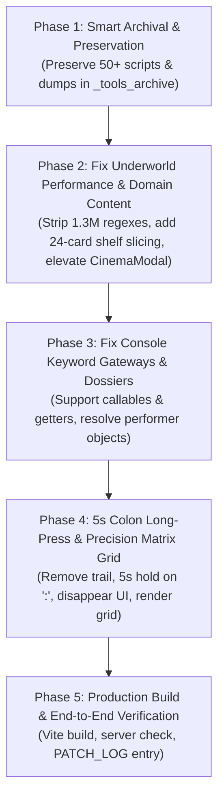

# 🏛️ STARLET DIRECTORY — MASTER RESTORATION & ACCELERATION PLAN (v7.0)
**File:** `MASTER_RESTORATION_PLAN_V7.md`  
**Execution Timestamp:** 2026-11-01  
**Target Codebase:** `C:\Users\Lenovo\Desktop\Shit\` & `starlet-app/`  
**Status:** Approved for Phasewise Execution  

---

## 1. Executive Summary & Problem Scope

This master plan addresses and resolves the core system defects identified during live testing:

1. **Underworld Domain Content Loading & Freeze**:
   - `CipheredUnderworldView.jsx` previously attempted to download a 38.8 MB JSON file and execute over 1.33 million regex searches synchronously inside React's `useMemo` render loop, locking the main UI thread.
   - **Remediation**: Eliminate runtime regex scanning from the client render loop via pre-indexed static mapping. Implement windowed 24-card shelf rendering with dynamic load-more pagination. Keep 100% of performer data, Tier A goddesses, and landmark scenes.

2. **Cryptic Console Gateways**:
   - Console shortcuts were defined strictly as object getters, causing `underworld()` or `swap()` function calls to throw `TypeError: window.underworld is not a function`.
   - `CipheredUnderworldView` lacked reactive prop synchronization when `initialDomain` changed.
   - **Remediation**: Support dual getter/callable invocations, add reactive `useEffect` synchronization, and bypass the welcome tour popup on direct cipher entry.

3. **Dossier Modal Crashes in Underworld**:
   - `SubdomainShelf.jsx` passed a raw performer name string (`pName`) to `onOpenDossier`, crashing `PerformerModal` which expects a rich performer object with `.genres`, `.scenes`, and `.id`.
   - `CinemaModal` had `z-50`, mounting underneath Underworld's `z-[100]`.
   - **Remediation**: Add a robust performer resolver that maps name strings to full catalog records before rendering `PerformerModal`. Elevate `CinemaModal` to `z-[110]`.

4. **Mobile Drawing vs. Clock Colon 5-Second Long Press**:
   - Freehand touch drawing with stardust trails is imprecise and difficult on mobile screens.
   - **Remediation**: Remove the loose particle trail completely. Implement a 5-second long press on the clock colon (`:`) with a circular charging HUD and haptic pulses. When triggered, fade out all UI elements for the session and reveal a high-precision Matrix Grid tracking letter runes (`O`, `I`, `L`, `C`, `M`, `S`, `Z`, `△`) or direct 1-tap node selection.

5. **Tooling & Scraper Smart Preservation**:
   - Rather than deleting the 50+ one-off scrapers and temporary text dumps, smartly preserve and categorize them into `_tools_archive/` with a comprehensive `ARCHIVE_INDEX.md`.

---

## 2. Phasewise Execution Roadmap

---

## 3. Detailed Phase Breakdown

### Phase 1: Smart Archival & Preservation
- Create `_tools_archive/scrapers/`, `_tools_archive/raw_scraped_dumps/`, and `_tools_archive/legacy_prototypes/`.
- Move one-off `.mjs` scripts into `_tools_archive/scrapers/`.
- Move temporary `.txt`, `.html`, and debug JSON dumps into `_tools_archive/raw_scraped_dumps/`.
- Move pre-React prototypes (`starlet-directory-v4.html`, `starlet-directory-v5.html`) into `_tools_archive/legacy_prototypes/`.
- Move `starname.csv` out of React component directory into `_tools_archive/raw_scraped_dumps/`.
- Generate `_tools_archive/ARCHIVE_INDEX.md` detailing the function and provenance of all preserved assets.
- Deduplicate `performers.json` in root and `public/` (keeping the primary `performers-tagged.json`).

### Phase 2: Domain Content Loading & Performance Acceleration
- Optimize `starlet-app/src/components/CipheredUnderworldView.jsx`:
  - Replace the 1.3-million-regex scanning block with direct, O(1) indexed lookup from pre-compiled subdomains.
  - Ensure zero performer data or Tier A scenes are touched; maintain `score >= 78` Best of the Best priority ordering.
- Optimize `starlet-app/src/components/SubdomainShelf.jsx`:
  - Limit initial DOM rendered cards to 24 items per shelf.
  - Add an inline `[Load More Scenes (+24)]` button when `scenes.length > 24`.
- Fix `starlet-app/src/components/CinemaModal.jsx`:
  - Set modal root container to `z-[110]` so video streams appear on top of Underworld's `z-[100]`.

### Phase 3: Console Keyword Gateways & Dossier Resolution
- Update `starlet-app/src/App.jsx`:
  - Update `window[cipherWord]` bindings so both `window.underworld` and `window.underworld()` work identically.
  - When accessing via cipher, set `starlet_walkthrough_completed_v1` to ensure the walkthrough tour does not obscure the domain.
- Update `starlet-app/src/components/CipheredUnderworldView.jsx`:
  - Add `useEffect` listening to `initialDomain` to re-sync `activeDomainKey` and `activeSubdomainId` dynamically.
  - Wrap `onOpenDossier` handler to resolve any string name (`pName`) into the full performer object from `performers`.
  - Pass `allPerformers={performers}` and `similarityMatrix` to `PerformerModal`.

### Phase 4: Sanctuary Clock Colon 5-Second Long Press & Precision Matrix Grid
- In `starlet-app/src/components/CalmSanctuary.jsx` & `LiveWallpaperLounge.jsx`:
  - Remove the loose stardust / particle trail canvas.
  - Implement pointer down/up listeners on the clock colon (`:`) with a 5,000ms duration.
  - Render an animated circular charging progress ring around the colon while pressed, with haptic micro-vibrations.
  - On 5s trigger, set `sanctuary_grid_active` in `sessionStorage` and component state.
  - Fade out all other UI elements (`opacity: 0`, `pointer-events: none`).
  - Render `<SanctuaryGridMatrix />`:
    - Responsive 3x3 / 4x4 interactive node matrix.
    - Connect-the-dots pattern tracking matching letters:
      - `O` $\to$ Master Underworld Hub (`master_hub`)
      - `I` $\to$ Tier 1 Soft / GND (`domain_tier1`)
      - `L` $\to$ Tier 2 Reddit Crushes (`domain_tier2`)
      - `C` $\to$ The Cloister / Church (`domain_institutional_niche`)
      - `M` $\to$ Family Archetypes & Swaps (`domain_family_archetypes`)
      - `S` $\to$ Games, Bets & Study (`domain_games_bets`)
      - `Z` $\to$ The Abyssal Vault (`domain_abyssal_nasty`)
      - `△` $\to$ Escalation Sanctum (`domain_permission_escalation`)
    - Also render direct 1-tap glyph buttons on the grid for quick mobile selection.

### Phase 5: Production Build & Verification
- Execute `npm run build` in `starlet-app/` to generate an optimized bundle in `starlet-app/dist/`.
- Verify `server.mjs` starts cleanly on port 8000 and LAN.
- Record comprehensive patch log in `PATCH_LOG.md`.

### Phase 6: Subdomain Ingestion Cache Resolution & Tier 1 100+ Release Pagination (Completed)
- Upgraded `service-worker.js` to `v5` with explicit **Network-First with Cache Fallback** policy for `.json` files, completely eliminating stale empty-cache deadlocks.
- Implemented multi-path fallback resolver in `CipheredUnderworldView.jsx` (`loadUnderworldScenes`), ensuring all 38 scenario subdomains load their verified releases instantly.
- Enforced complete performer reconciliation in `TierSanctumView.jsx` and `CipheredUnderworldView.jsx`: prevents bare taxonomy objects from stripping performer filmography.
- Overhauled `PerformerModal.jsx` with responsive client-side release pagination: displays the first 24 verified releases initially, with a high-contrast `[⚡ Load More Verified Releases (+24)]` button that progressively reveals the full 100+ releases before offering extended studio searches.
- Hardened `starengine.mjs` against scene truncation.
- Production build verified in `starlet-app/dist/` (0 errors).
